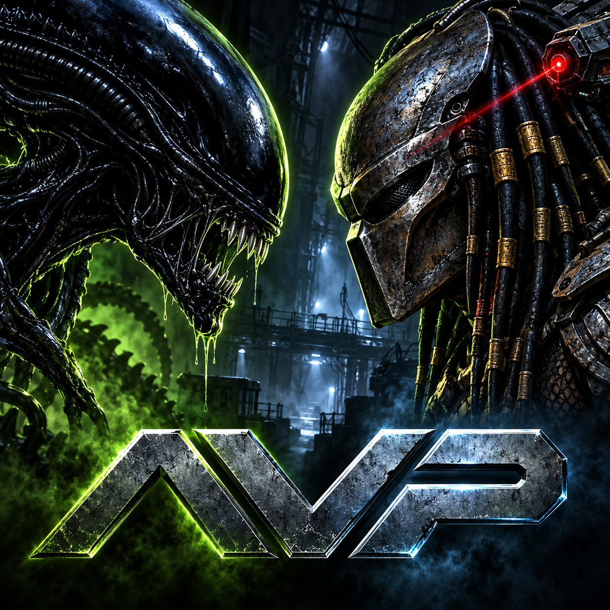

# Aliens versus Predator — OpenOrbis PS4



PS4 port maintained by [Nichlas Ek](https://github.com/NichlasEk).

**v0.4.0 — early playable PS4 port.**
[Downloads](https://github.com/NichlasEk/AVP-PS4/releases/tag/v0.4.0) ·
[Install / HDD / USB](docs/INSTALL.md) · [Release verification](docs/RELEASE-STATUS.md).

Experimental native source port of Rebellion's Aliens versus Predator (1999),
using the Icculus 20170505 source release. The original game and source code are
copyright Rebellion Developments 1999–2000. Noncommercial use only; see LICENSE.

Version 0.4 has been reported working well on a physical PS4 by the tester.
This is an early playable port, not a completed compatibility release.
Menu navigation and the first Alien, Marine and Predator levels have rendered in
shadPS4. Physical PS4 versions 0.2 and 0.3 crashed on startup (CE-34878-0).
0.3 localized the failure to the engine's desktop directory initialization.
Version 0.4 replaces that path with native PS4 directory setup; the tester
subsequently confirmed successful startup and apparently trouble-free gameplay.
That report is not exhaustive campaign, audio or performance validation.

Bring your own legally obtained game data. This repository includes no retail
game assets, disc images or original game executables. The generated project icon
is included. This is an unofficial port, not affiliated with Rebellion.

## Package and game data

`AvP-PS4-v0.4.0.pkg`, title ID `AVPS00001`, version `00.04`.
This package contains the engine, icon and runtime libraries, not commercial game
data. Earlier 0.1/0.2 private packages do contain game data; do not publish those.
The accompanying manifest records every packaged file and its SHA-256.

Profiles and logs go under `/data/avp/`. Game data is selected as one complete root:

1. `/data/avp/gamedata/` on the internal HDD.
2. `/mnt/usb0/avp/gamedata/` through `/mnt/usb7/avp/gamedata/`, in order.

Each root contains `avp_huds/`, `avp_rifs/`, `fastfile/` and `language.txt` from
`build/data/` (the imported, lowercase and compatibility-adjusted data, not just
the original ISO contents). Put these under `avp/gamedata/` at the USB root.
Do not put the ISO itself there. Core files must be readable and nonempty before
a root is selected; missing HDD core files allow USB fallback. Files from different
roots are never mixed. Saves/profiles stay on HDD even when loading USB data.
There is no `/app0/data` fallback in version 0.3.

`/data/avp/bootstrap-v04.log` records startup stages using direct kernel writes.
On PS4, engine directory setup now reuses the validated data root directly and
checks `/data/avp/.avp` with native directory calls. It no longer repeats the PC
HOME/PATH/access/stat path search or deletes `dx_error.log` at startup. Existing
saves are preserved; failure to open the save directory is logged and exits cleanly.
The optional USB mouse bootstrap in the shared SDL backend is disabled by the
packaged `scummvm-controller-only.txt` marker; DS4 controls remain enabled.

## Controls

| Control | Action |
|---|---|
| D-pad / left stick in menus | Navigate |
| Cross / Circle in menus | Confirm / back |
| Options | Pause / escape |
| Left stick in game | Analog move / strafe: gentle tilt for slow movement, full tilt for running |
| Right stick | Look, with a progressive precision curve |
| Cross / Circle or R3 / Square | Jump / hold crouch or Alien wall-walk / operate |
| R2 / L2 | Primary / secondary attack |
| R1 / L1, Marine and Predator | Next / previous weapon |
| L1 / R1, Alien | Jump / hold wall-walk: keep both thumbs on the sticks |
| Triangle | Marine previous-used weapon / Predator cloak / Alien vision |
| D-pad up | Marine image intensifier / Predator vision cycle / Alien vision |
| D-pad down | Marine flare / Predator disc recall / Alien taunt |
| D-pad left/right | Marine previous/next weapon; Predator zoom out/in |
| Hold L3 | Precision movement: walk modifier and reduced look sensitivity |

New profiles have a suggested name so a keyboard is not required. Mappings follow
the selected profile's action bindings. The original game reloads automatically;
Square is interaction, not a fake manual-reload binding. Movement uses a 15% radial
deadzone, look 12%; diagonal movement is normalized. Look rates are frame-time
scaled by the engine, independent of legacy mouse sensitivity. Invert-look still
uses the profile's vertical-inversion setting. Auto-centering is disabled for pad
play. Held buttons are released on disconnect and guarded across menu/game
transitions. Feedback from additional physical DS4 testing is welcome.

Version 0.2 includes a generated Alien/Predator face-off icon. Source image:
`assets/icon-generated-v02.png`; full built-in image-generation prompt:
`assets/icon-v02-prompt.txt`. Packaging makes a 512x512 opaque RGB icon.

## Build on this workstation

```sh
python3 scripts/prepare-source.py
python3 scripts/import-media.py media/AvP_disc1.iso  # once, fresh build/data only
bash scripts/build-ps4.sh
python3 scripts/package-ps4.py
python3 scripts/verify-package.py
bash scripts/test-platform.sh
```

`prepare-source.py` verifies the source archive and the published Icculus English
compatibility file by SHA-256. The retail disc's original language table has
different indices and is not compatible with the released Gold source.
`engine/`, `media/`, `build/`, `dist/` and test artifacts are ignored by Git.
Patches are stored in `patches/`; do not leave engine edits out of that overlay.

The current PS4 build reuses the existing sibling `ScummVM-PS4` Vulkan/GL/SDL
implementation and `Doom3-Ps4` OpenAL/audio/TLS implementation, plus
`/opt/openorbis/OpenOrbis/PS4Toolchain`. It does not rebuild or modify those
projects. Their built dependencies must exist. Paths can be overridden with
CMake's `SCUMMVM`, `DOOM3`, and `OO_PS4_TOOLCHAIN`. Set `CREATE_FSELF` to override
the local current OpenOrbis fself tool. This is not yet a standalone SDK bootstrap.

Linux baseline:

```sh
cmake -S . -B build/linux -G Ninja -DCMAKE_BUILD_TYPE=RelWithDebInfo
cmake --build build/linux -j12
AVP_DATA="$PWD/build/data" build/linux/avp -w -c
```

Requires SDL2, OpenAL, OpenGL and C/C++ development tools. Linux stores profiles in
`~/.avp`. `scripts/smoke-emulator.sh alien|marine|predator [runtime-directory]`
uses an isolated Xvfb screen and the local shadPS4 executable, with an existing
test profile. Screenshots must be inspected; process survival alone is not a pass.
`test-input.sh` uses the real adapter with a mocked pad/engine boundary and ASan/
UBSan: exhaustive stick samples, all species' buttons, held attacks, transition
guards, neutral/disconnected state, focus, inverted look and precision mode.
It is not a physical controller-feel test.

Explicitly requested LAN delivery can use `scripts/deliver-ftp.py PACKAGE --host
PS4_IP --port 2121`. It refuses an existing remote filename, uploads to a
temporary name and verifies full FTP readback before renaming under `/data/pkg/`.
It does not install or launch the package on the console.
`python3 scripts/deliver-data.py --host PS4_IP` uploads the separate data
tree, reads back all files and only then renames it to `/data/avp/gamedata`.
It refuses to replace an existing data tree. Version 0.3 delivery verified
149 data files (146386796 bytes); the NoData PKG is 27459584 bytes.

## Implemented and outstanding

The port includes the original gameplay code, a repaired SDL2 main loop and
viewport query, Vulkan presentation at 1280×720, floating-point vertex-color
conversion, profile-based controller actions, and OpenAL loopback output to PS4
AudioOut at 48 kHz stereo. No Piglet/Shacc graphics modules are imported.
RIF decoder lookahead is bounded and empty weapon slots are skipped before indexing
weapon/ammo tables; these fixes address errors found by AddressSanitizer during
the first Alien level load.

The initial renderer draws directly to the display rather than using the SDL2
port's supersampling framebuffer. Decal polygon offset is not yet applied, so
decal depth artifacts remain possible. Intro/in-game FMV and CD audio are not
implemented in this baseline. Multiplayer is not validated or offered as working.
Full campaigns, save/load recovery, all weapons/vision modes, memory longevity,
console suspend/resume and broader physical PS4 compatibility still require testing.

## Licensing and distribution

Rebellion are the creators and owners of the original game source. Their
noncommercial source license is preserved in [LICENSE](LICENSE); this project
must not be represented as MIT/GPL-licensed or used commercially.

Do not redistribute your ISO, imported data, compatibility language text or the
older private test packages. Retain the source/relink companion and all notices
when redistributing the binary. Independent libraries retain their own licenses;
see [third-party notices](docs/THIRD-PARTY.md) and [relinking](docs/RELINKING.md).

Sources: [Icculus AvP](https://icculus.org/avp/),
[source archive](https://icculus.org/avp/files/avp-20170505-a1.tar.gz),
[compatibility language file](https://icculus.org/avp/files/etc/english.txt).
